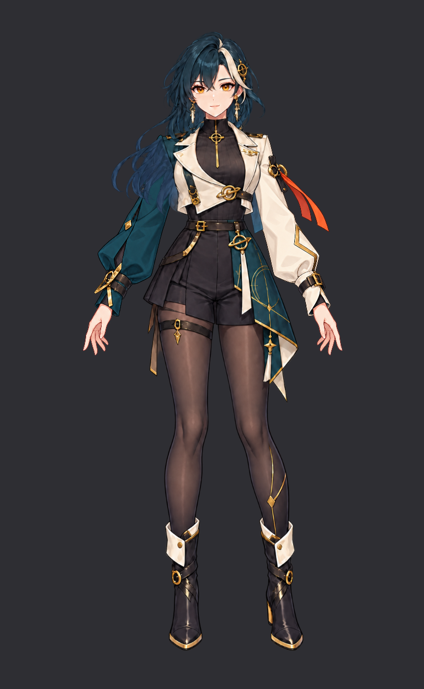

# Puppet examples

Open the bundled `.puppet` in **File > Examples > Imeru**, **Open Puppet…**,
or **Desktop Pet > Load bundled Imeru**.

| File | Subject | Drawables | Parameters | Motions | Expressions |
|---|---|---|---|---|---|
| `imeru.puppet` | Imeru, Imervue's original mascot | 23 | 31 | 8 | 7 |

## `imeru.puppet`

Imeru uses a complete modern anime illustration with flowing teal hair,
an asymmetric fitted jacket, gathered sleeves, layered side sash and detailed
boots. The design combines fashion tailoring, restrained techwear and celestial
Art Deco ornaments. Her entire silhouette follows the
[full-body design reference](imeru/concepts/modern-full-body.png).



[Waving pose from the same rig](imeru/preview-wave.png).
[Animated wave from the bundled motion](imeru/preview-wave.webp).

These previews come from the executable model. The model includes the stored
transparent illustrations in [`imeru/artwork/`](imeru/artwork/):

* `master.png` supplies the original face details.
* `underlay.png` supplies the continuous body, head and full hair, with hidden
  shoulder regions completed and blank skin beneath animated facial features.
* `arms.png` supplies complete sleeves and relaxed hands, including sleeve
  surfaces previously hidden by the hair.
* `alternates.png` supplies closed eyelids, an open mouth and open palms.

Rebuild the archive from these stored assets with:

```
py -3 examples/puppet/imeru/build.py
```

The illustrated build does not require Blender or an image-generation service.
`illustrated.py` assembles the source regions and registers arm landmarks.
`illustrated_mesh.py` builds meshes and UV coordinates referencing the unchanged
PNG pixels. `illustrated_rig.py` defines deformation fields and arm bindings.
The older Blender authoring code remains available through `build_native()`;
it does not supply the default illustrated artwork.

The 1024 × 1664 model keeps the body, head and hair on one continuous mesh.
The original 1024 × 1536 artwork has 64 pixels of motion room above and below.
Each sleeve also remains continuous across the elbow. An identity bone and an
elbow bone blend the sleeve deformation before the shoulder rotation runs.
The jacket and hair overlap the sleeve roots. Hands change beneath the cuffs.
This keeps the illustration connected during motion without outlining separate
upper-arm and forearm pieces.

The rig supports:

* Head turns, nods and rolls through local deformation with a smooth neck
  transition. Breathing affects the upper body and leaves the boots planted.
* Blinking, smiling eyes, gaze, brow movement, cheek tint and speaking mouth
  shapes using the illustrated facial details.
* Both two-joint arms, open-palm waving and three hair-physics inputs.
* Standard parameters for webcam tracking, automatic blinking, cursor look-at
  and microphone lip-sync.
* Eight motions: `idle_breath`, `idle_look`, `tap_head`, `shy`, `greet`,
  `wave`, `surprised` and `sleepy`.
* Seven expressions: `smile`, `happy`, `surprised`, `sad`, `angry`, `blush`
  and `sleepy`.

The Desktop Pet's matching voice is
[`../desktop_pet/imeru.petscript.json`](../desktop_pet/imeru.petscript.json):
greetings, a line for each time of day, replies to clicks on her `Head`
and `Body`, lines for her motions and a stretch reminder.

### Try it

Launch Imervue, switch to the **Puppet** tab and pick **File > Examples >
Imeru**. Click any motion in the bottom Motions dock to play it, or click
her head or body.

Toggle the toolbar features to drive the rig live:

* **Auto idle** + **Idle motions** — breath + cycling Idle clips.
* **Auto-blink** — eye-open/close.
* **Drag-track head** — cursor look-at via `ParamAngleX/Y`.
* **Mic lip-sync** — viseme drives mouth open + form.
* **Webcam tracking** — face landmarks drive head + eyes + mouth.
* **Virtual camera** / **NDI output** — stream the puppet into
  OBS / Zoom. See [`puppet_guide.md`](../../puppet_guide.md) at the
  repo root for the full end-to-end walkthrough covering both live
  streaming (Virtual Camera + NDI + chroma-key recipe) and
  animation production (motion record / timeline edit / MP4 export).

### Authoring your own from scratch

1. **Drawable** — start from any PNG via **Import PNG…** (the
   auto-mesh step replaces the manual vertex / index arrays).
2. **Deformer** — `Add Rotation Deformer` for head turns, `Add Warp
   Deformer` for cheek squashes / clothing folds.
3. **Parameter** — `Add Parameter` for each rig axis you want to
   drive (`ParamAngleX/Y/Z`, `ParamEyeLOpen`, `ParamMouthOpenY`, …).
4. **Keys** — drag the slider to an extreme, edit the deformer's
   form, press **Set key** in the parameter dock to snapshot the form
   at that slider value. Repeat at neutral and the opposite extreme.
5. **Motion** — toggle **Record motion**, drag sliders / use webcam
   tracking / let physics run, toggle off — the take is baked into a
   linear-segment Motion.
6. **Save** — **Save As…** writes the whole rig to a `.puppet` zip
   you can share.

Or build one in code the way `imeru/` does: render or draw layers, mesh them with
`Imervue.puppet.auto_mesh.triangulate_alpha_grid`, add vertex morphs,
deformers, motions and expressions to a `PuppetDocument`, and save it
with `Imervue.puppet.document_io.save_puppet`.

See `Imervue/puppet/FORMAT.md` for the full file-format reference.
